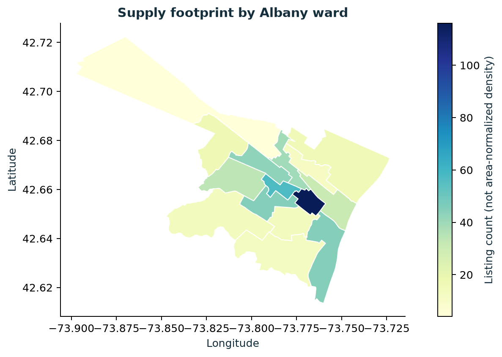

# Airbnb Market Lab

**An independent, AI-assisted personal portfolio project in data engineering and market analytics.**

Turn a dated Inside Airbnb snapshot into an auditable DuckDB warehouse, an offline market explorer, statistical analysis, a price-model benchmark and a generated 22-page report. Built around real Albany data, with no API keys or paid cloud services.



## Start here

1. Read the [portfolio report](outputs/albany/2026-09-14/market_report.pdf).
2. Download/clone the project and open [the offline explorer](outputs/albany/2026-09-14/explorer.html) in a browser. GitHub displays its source; it does not host the interactive page.
3. Follow the [annotated notebook](notebooks/01_market_walkthrough.ipynb).
4. Review the [architecture and decision log](docs/architecture.md), [verification record](docs/verification.md) and [career guide](docs/career-guide.md).

## What the actual run found

| Measure | Albany snapshot |
|---|---:|
| Archive date / observed listing scrape date | 2026-09-14 / 2026-09-16 |
| Listings / observed host accounts | 500 / 200 |
| Calendar rows / review records | 182,500 / 30,251 |
| Positive-price listings / missing prices | 467 / 33 |
| Median / mean listed nightly price | USD 144.00 / USD 292.59 |
| Supply held by largest 10% of host accounts | 44.2% |
| Mean listing-level unavailable share | 30.9% |

**Unavailable does not mean booked.** Host blocks and bookings cannot be separated. This snapshot's calendar has **no price column**, so seasonal prices, weekend price premiums and calendar-based revenue cannot be measured. No values were fabricated to fill that gap.

The median-price baseline beat Ridge, Extra Trees and histogram gradient boosting on training group-CV MAE. Its held-out-host MAE is USD 92.46/night. The mean is distorted by a long price tail (maximum USD 11,680); this is evidence for careful validation, not a deployable pricing recommendation.

## Run locally

Tested with Python 3.12 on Windows. Python 3.11+ is supported by the package specification, but the exact pinned environment was validated on 3.12.

```powershell
python -m venv .venv
.\.venv\Scripts\Activate.ps1
python -m pip install -r requirements.lock
python -m pip install -e ".[dev]"
python -m airbnb_lab.cli run
python -m pytest -q
```

On macOS/Linux, activate with `source .venv/bin/activate`; the remaining commands are the same. If PowerShell activation is restricted, call `.\.venv\Scripts\python.exe` directly instead of changing your execution policy.

```powershell
# Reuse verified downloads with no network access
python -m airbnb_lab.cli run --offline

# Force a deterministic rebuild of analytical results
python -m airbnb_lab.cli run --offline --force
```

The first run downloads seven public source files. Later runs validate checksums; unchanged source/config/code/environment and verified artifacts skip processing. Network access is only needed for dependencies and initial ingestion. Source availability can change; the dated manifest records the exact URLs and SHA-256 hashes used.

After setup, `scripts/run-demo.ps1` runs the pipeline and opens the explorer. The local `.venv` is not part of the repository.

## Docker alternative

```sh
docker compose run --rm --build pipeline
docker compose run --rm pipeline run --offline
```

Docker must be installed and its daemon running. See the verification record for what was actually tested; container execution is not claimed when the local daemon is unavailable.

## Project layout

```text
configs/                 Dated city config, source map and currency
src/airbnb_lab/           Ingestion, quality, warehouse, analysis and reporting
tests/                   Synthetic edge-case and integration tests
sql/analytics.sql        Six analytical SQL examples
notebooks/               Executable guided exploration
docs/                    Design, assumptions, learning and validation
data/raw/                Original source files + source hashes (ignored)
data/extracted/          Recreated CSV/GeoJSON cache (ignored)
data/warehouse/          One DuckDB file per city/snapshot (ignored)
outputs/albany/2026-09-14/ Shareable results, charts, explorer and report
```

Useful outputs include `schema_profile.json`, `quality_report.json`, `analysis.json`, `source_manifest.json` and `run_manifest.json`. Statistical details include effect sizes, confidence intervals, assumption diagnostics and sensitivity tests. Full local analytical tables retain source IDs as strings; public artifacts exclude identities and review text.

## Engineering features

- Bounded retries, partial-file promotion, gzip integrity checking and source hashes.
- Explicit schema and domain checks; large-ID preservation; unknown availability stays null.
- Schema evolution handling: bathroom text parsing and account-duration fallback when dates are absent.
- Deterministic key deduplication, fuzzy candidate flagging, referential validation and source reconciliation.
- Snapshot star schema with primary keys, analytical views and documented lineage.
- Host-cluster bootstrap price intervals; representative-host tests with Holm correction; OLS with clustered errors and VIF.
- Three model families plus baseline, fold-local preprocessing, unseen-host holdout, residual slices and permutation importance.
- Configurable city paths, dates and currency. Only Albany has been validated end to end; audit new-city schemas and semantics before trusting their outputs.

## Honest boundaries

This is a locally runnable portfolio implementation, not an operated production service. Snapshot-level incremental processing is implemented; row-level CDC and concurrent writer locking are not. One snapshot cannot establish causal effects, true occupancy or temporal model generalisation. Cloud deployment, NLP/RAG, automated price advice and cross-city validation are future work.

AI assistance is disclosed in [docs/ai-disclosure.md](docs/ai-disclosure.md). For interviews, run and explain the system yourself and distinguish generated work from your own subsequent contributions.

## Sources and attribution

- [Inside Airbnb downloads](https://insideairbnb.com/get-the-data/) — source data, CC BY 4.0.
- [Inside Airbnb data assumptions](https://insideairbnb.com/data-assumptions/) — source interpretation.
- [Official data dictionary](https://docs.google.com/spreadsheets/d/1iWCNJcSutYqpULSQHlNyGInUvHg2BoUGoNRIGa6Szc4/edit?usp=sharing).
- [scikit-learn GroupShuffleSplit](https://scikit-learn.org/stable/modules/generated/sklearn.model_selection.GroupShuffleSplit.html) and [SciPy Welch test](https://docs.scipy.org/doc/scipy/reference/generated/scipy.stats.ttest_ind.html).

Derived data and figures attribute Inside Airbnb. The project does not redistribute the original private brief. It is not affiliated with Airbnb or Inside Airbnb.
