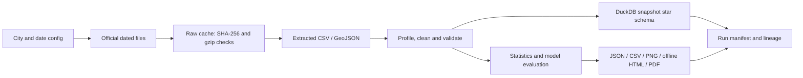
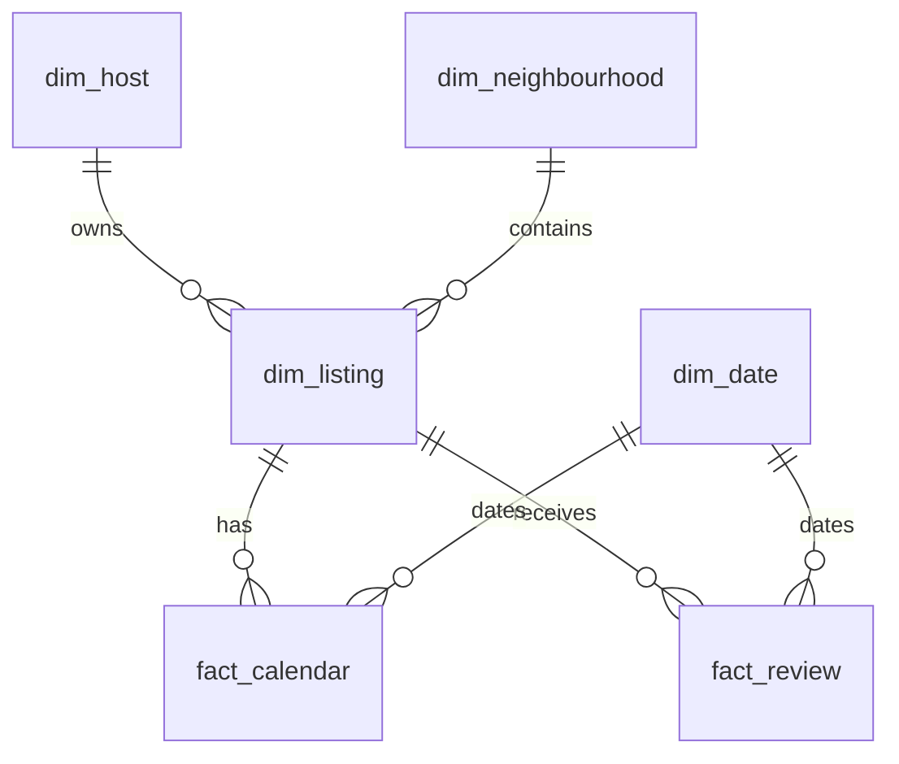

# Architecture and engineering decisions

The analysis and warehouse consume the same validated frames. Analytics does not re-read the warehouse; the database provides a separately queryable SQL artifact. Both outputs are reconciled by row counts and integration tests.

## Dimensional relationships

One database = one city and archive date. Within it, listing ID and review ID are unique; calendar grain is listing ID + date. IDs remain strings to prevent loss of precision. Source reviewer identities and comments do not enter the warehouse. Listing coordinates are retained locally for analysis, but the shared explorer contains no coordinates or IDs.

Foreign-key relationships are asserted in code; only primary keys are database constraints. The enriched listing dimension denormalizes review counts and calendar coverage for convenience. This is a pragmatic small-market schema, not a claim of a complete enterprise dimensional warehouse.

## Decision log

| Decision | Options considered | Choice and trade-off |
|---|---|---|
| Local analytical engine | SQLite, DuckDB, PostgreSQL | DuckDB: analytical SQL and constraints without server operations; single-process publication limits concurrency. |
| Processing | pandas, streaming SQL, Spark | pandas at Albany scale: clear transformations and tests; memory scales with full inputs. |
| Temporal storage | Overwrite latest, row CDC, immutable snapshots | City/date snapshots + skip cache: auditable and simple; no row-level change history. |
| Missing prices | Median imputation, dropping listings, null retention | Retain listings/nulls; price-only analyses exclude nonpositive values. Supply counts remain complete. |
| Outliers | Delete, cap, retain | Retain with IQR flags; expose the effect on mean and model errors. Robust modeling is a documented future experiment. |
| Duplicates | Automatic fuzzy deletion, deterministic key policy | Exact keys keep last in source order; fuzzy matches are local review candidates only. |
| Holdout | Random listing split, host split, temporal split | Host split prevents within-account leakage. Temporal generalisation needs another snapshot. |
| Model selection | Holdout tuning, training CV | Fixed models selected only by group CV. Holdout is reported once for the final schema-corrected experiment. |
| Statistical units | All listings independent, representative hosts, multilevel modeling | One representative per host for H1-H4; simpler independence story at the cost of a changed estimand. |
| HTML explorer | Hosted web service, Streamlit, offline artifact | Self-contained HTML: zero services/API keys; small-market data embedded without identifiers. |
| Report | Hand-edited figures, generated report | Generated from one result object; fewer transcription risks, fixed editorial layout. |
| AI features | Add chatbot/NLP, deepen engineering | Defer AI features without evaluation labels. Invest in source handling and truthful outputs. |

## Incremental and failure semantics

The fingerprint includes source hashes, config, all Python package files, Python version and analytical package versions. Unchanged runs skip only if every recorded artifact (including the local warehouse) still matches its hash. Re-download occurs if the verified raw cache fails validation during an online run; offline mode fails instead.

Each new snapshot has its own paths. Calendar rows are not appended to a previous snapshot because the same future date can change state between scrapes. Reviews across snapshots are repeated observations, not automatically new reviews. A future CDC layer should compare listing keys/attribute hashes and preserve first-seen, last-seen and deletion semantics.

Raw downloads and the warehouse are promoted atomically. Presentation files are produced sequentially and the success manifest is written last. A failed run's outputs must not be consumed as a complete bundle. There is no distributed lock; do not run two writers for the same city/date simultaneously.

## Scale roadmap

For 50+ cities, move raw storage to immutable object storage, partition calendar facts by city/snapshot/month, stream larger CSVs into an analytical engine, and schedule bounded city-level jobs. Add a metadata catalog, missingness/schema drift alerts, snapshot freshness targets and retries isolated by city. Introduce a dated listing snapshot fact with surrogate keys if combining databases.

No cloud account, paid resource or external model endpoint was used. Infrastructure costing and service-level objectives require an agreed volume/freshness target; no speculative production guarantees are made.
